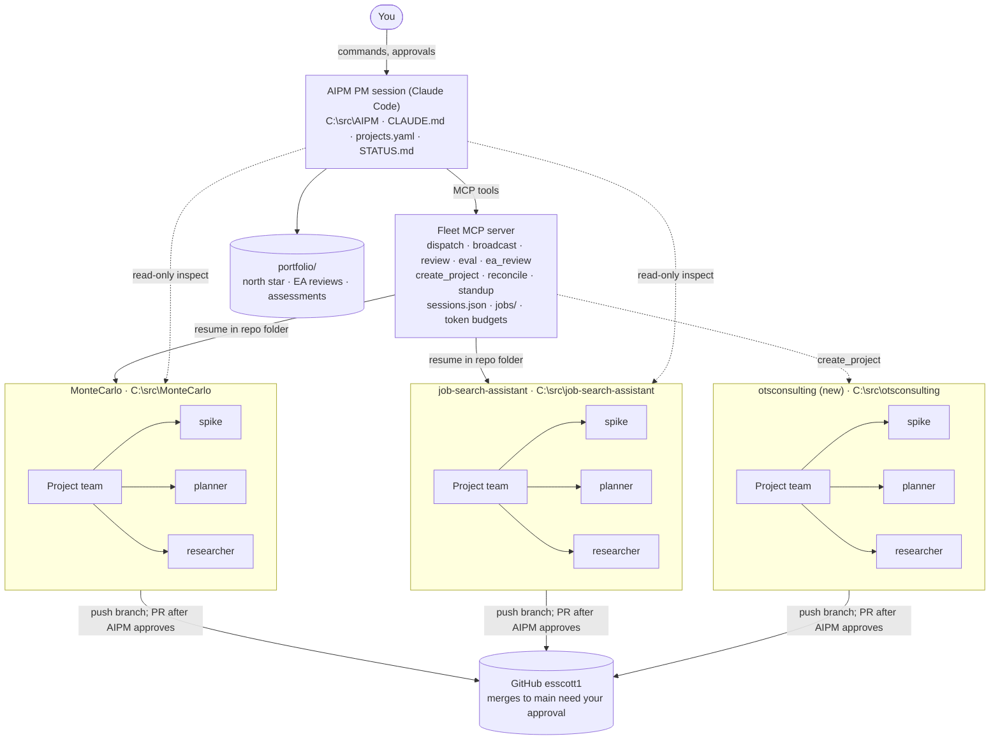
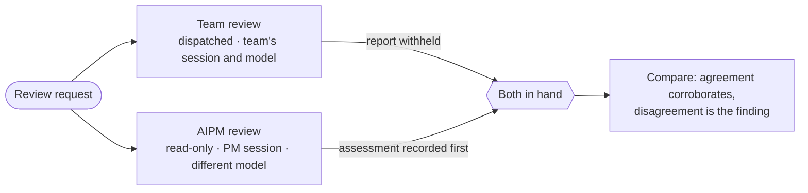
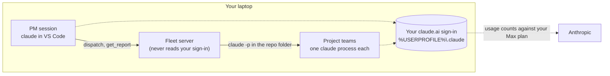

# AIPM — AI Program Manager Architecture

As of 2026-10-26 · Eric Scott

## Summary

AIPM is one Claude Code session that acts as program manager over every repo, so you stop switching between per-repo sessions. It talks to a small MCP server (the fleet server) that runs one persistent project team per repo through the unmodified Claude Code CLI.

- **Managed at launch:** MonteCarlo, job-search-assistant, and otsconsulting (created by AIPM).
- **Project teams** keep long-lived context in their own repo and spawn subagents for spikes, planning and research.
- **The work:** AI engineering implementation through each repo's own process framework, architecture and roadmap review, north star setting and review, and evals — created and run across every adopted repo.
- **Two points of view.** An assessment can be dispatched to a team, which answers from inside its own session, or made by AIPM reading the repo itself. Running both gives a second opinion from a different session and a different model, under the independence rule.
- **Enterprise architect.** AIPM also looks across the portfolio — the set of adopted projects — and recommends what no single project can see. Its recommendations are advice; you decide what gets built.
- **AIPM can bootstrap new projects:** create the folder, `git init`, create the GitHub remote, push, and register the team.
- **Home:** `C:\src\AIPM`, its own repo, pushed to `github.com/esscott1/AIPM`. Portfolio-level output lives in `portfolio/`.

## Architecture



You talk only to the PM session. The PM calls the fleet server's MCP tools, and the fleet server resumes each project team inside its own repo folder. Teams commit to and push their own feature branches; the PM approves each pull request before it is opened, and nothing merges to `main` without you.

AIPM also reads adopted repos directly, shown by the dotted arrows, so it can assess a project without dispatching to its team. That path is read-only: every change to a repo still comes from a task its own team runs.

## Components

| Component | Lives in | Responsibility |
| --- | --- | --- |
| PM session | `C:\src\AIPM` (Claude Code) | Takes your commands, dispatches work, keeps `STATUS.md` current, approves PR requests, asks you before merges and repo creation |
| Fleet MCP server | `C:\src\AIPM\fleet` (Python, native Windows) | Runs project team sessions, stores session IDs, tracks background jobs and token budgets |
| Registry | `projects.yaml` (local, not in git) | Repo path, GitHub remote, goal, model, permission mode, token budget, status per project; written by the fleet tools |
| Project teams | One per repo | Claude Code session with `cwd` = the repo; uses that repo's CLAUDE.md, memory.md, skills and hooks |
| Subagents | Each repo's `.claude/agents/` | Spike, planner, researcher; spawned by the project team for scoped tasks |
| AIPM's own subagents | `C:\src\AIPM\.claude\agents\` | Enterprise architect, architecture reviewer, eval author; they read adopted repos but never write to them |
| Portfolio tree | `portfolio/` in `C:\src\AIPM`, or wherever `portfolio_path` points | Portfolio north star, enterprise architect reviews, AIPM's own assessments, cross-project eval results and decisions |
| AIPM's own evals | `evals/` in `C:\src\AIPM` | AIPM's eval suites and fixture repos: Tier 1 against `fake_claude`, Tier 2 against real `claude -p` |

**Fleet MCP tools**

- `list_projects`, `project_status(project)`
- `dispatch(project, instruction, mode)` returns a running job at once; `get_report(job)` returns its state and the team's report (see Dispatch and jobs). `job_status(job)` and `cancel(job)` come in Phase 2
- `broadcast(instruction, projects)` for the same ask across repos (e.g. "bump dependencies" or "clean up")
- `request_pr(project, branch, summary)` from a team, and `approve_pr(request)` / `reject_pr(request, reason)` from the PM
- `notify_merged(project, pr)` tells a team its PR was merged, so it can run its cleanup
- `create_project(name, visibility, template)` for the bootstrap flow below
- `standup()` rolls up git log, open PRs, the last team report and tokens used per repo
- `inspect_project(project)` reads an adopted repo read-only, so AIPM can assess it without dispatching to its team
- `review(project, kind)` asks a team to assess its own `architecture`, `consistency` or `northstar` and report back
- `eval_create(project, target)` and `eval_run(project)` build and run a project's evals; `broadcast` runs them across repos
- `ea_review(question)` is a portfolio-level assessment across every adopted repo, written to the portfolio tree

**Lifecycle tools:** `adopt_project`, `retire_project`, `pause(project)`, `resume(project)` and `reconcile(project)`, which brings AIPM up to date with anything done in the repo outside it.

**State:** git is the source of truth (a branch and PR per task). `fleet/jobs/` holds one record per job, and `STATUS.md` is the rolled-up board. Each field has one home:

- `projects.yaml` is the registry. `/adopt-project` and `create_project` add entries, `pause` and `resume` set `status`, and `/retire-project` removes entries. You can edit a budget or model by hand, but never need to.
- `fleet/sessions.json` holds what changes on every run: each project's `session_id` and `last_seen_commit`.
- `fleet/queue.json` holds tasks dispatched while a project was paused, until you dispatch or discard them.

These files are machine-local and stay out of git, since they hold `C:\src` paths and change without a PR. `projects.example.yaml` documents the registry format. If this machine is lost, the registry is rebuilt by adopting each repo again; the repos themselves are on GitHub.

**Host: Windows.** The fleet server runs natively on Windows, the same environment as `C:\src`, VS Code and the Claude desktop app. That keeps one Claude Code session store (`%USERPROFILE%\.claude`) and one set of paths, so forks and `reconcile` work with sessions you run in VS Code, and the Control Panel connects to it directly as a local MCP server. Teams use your Windows `claude` and `gh` sign-ins, and their shell commands run in Git Bash. WSL is fine for one-off git and `gh` commands, but Claude Code sessions for an adopted repo always run on Windows: WSL keeps a separate session store and sees the repos as `/mnt/c/...`, so sessions don't carry across.

## Managed projects

Two existing repos are adopted at launch; otsconsulting is created by AIPM as its first bootstrap.

| Project | Local path | GitHub remote | Onboarding |
| --- | --- | --- | --- |
| MonteCarlo | `C:\src\MonteCarlo` | `esscott1/MonteCarlo` | Adopt with `/adopt-project`; the team starts fresh |
| job-search-assistant | `C:\src\job-search-assistant` | `esscott1/job-search-assistant` | Adopt: same as above |
| otsconsulting | `C:\src\otsconsulting` | `esscott1/otsconsulting` (new) | Bootstrap via `create_project` |

Local paths assume everything sits under `C:\src`; the path is recorded when a repo is adopted or created.

Example registry entry (see `projects.example.yaml`):

```yaml
portfolio_path: portfolio          # relative to C:\src\AIPM, or an absolute path

projects:
  montecarlo:
    path: C:\src\MonteCarlo
    remote: https://github.com/esscott1/MonteCarlo.git
    goal: Featured portfolio project; client-ready simulation
    model: sonnet
    permission_mode: acceptEdits   # plan | acceptEdits; bypassPermissions is rejected
    budget: { max_tokens_per_job: 100000 }   # max_turns is optional
    framework: spec-kit            # spec-kit | gsd | openspec | none
    context_docs: [docs/architecture.md, docs/roadmap.md]
    northstar: docs/roadmap.md     # the doc that states where this project is going
    status: active                 # active | paused
```

`portfolio_path`, `framework`, `context_docs` and `northstar` are the target schema, not the current one: the registry model sets `extra="forbid"`, so they are rejected until they are added to `fleet/registry.py` (a Phase 1 item, so the schema doesn't need migrating later). `projects.example.yaml` documents only what the code accepts today.

The matching `fleet/sessions.json` entry, written by the fleet server and `reconcile`:

```json
{ "montecarlo": { "session_id": null, "last_seen_commit": null } }
```

## Dispatch and jobs

`dispatch` starts a team task in the background and returns a job right away, because a task can take minutes and the PM session shouldn't wait on it. The PM polls `get_report` until the job ends.

1. **Checks:** the project exists, isn't paused, its folder exists, and it has no other job running. A project runs one job at a time, because two runs resuming one session would fork its history. A dispatch to a paused project starts nothing: it reminds you the project is paused and not taking new work, and saves the task to the project's queue (see Pause and resume).
2. **Mode:** the project's `permission_mode` is the ceiling. A dispatch may ask for `plan` on an `acceptEdits` project, never the reverse.
3. **Run:** the fleet server runs `claude -p <task> --output-format json --permission-mode <mode> --model <model> --json-schema <report>` in the repo folder, adding `--resume <session_id>` once the team has a session and `--max-turns` only if the project sets one.
4. **Brief:** each task carries a short AIPM brief: follow the repo's CLAUDE.md and memory.md, work on a feature branch, don't open a pull request, finish with the report. It goes in the prompt rather than `--append-system-prompt`, which is recorded once per session and would never reach existing teams if it changed. A team with no session yet (a fresh start) also gets an orientation ahead of its first task: read the project's `context_docs` first.
5. **Result:** the job record in `fleet/jobs/<id>.json` ends as `succeeded` with the report, or `failed` with the reason. The returned `session_id` is saved to `sessions.json`.

| Outcome | What happens |
| --- | --- |
| Team finishes | `succeeded`; `report` has summary, branch, changed, tests, blockers and next_step; `tokens_used` is counted by the fleet server |
| Over the token cap | Flagged with `over_token_cap`; the job is not stopped |
| Max plan usage limit hit | `failed` with claude's message and reset time; the session is saved, so the next dispatch picks up where it stopped |
| Saved session can't be resumed | `failed`; the fleet server never starts a fresh session in its place, which would drop the team's context |
| Fleet server stops mid-job | `lost` once the job's file stops being refreshed (every 30 s); the `claude` process may still finish on its own |

### Dispatching through the project's framework

A repo that runs a process framework has one way in, and AIPM uses it rather than handing the team raw prose. MonteCarlo and AIPM run Spec Kit, job-search-assistant runs GSD, and a repo may run neither.

- The registry records each project's `framework`. The dispatch brief names it and tells the team to enter through it, so the same ask becomes that repo's own first step: a feature on a Spec Kit repo starts with its specify step, on a GSD repo with its own.
- `framework: none` means the team works to its `CLAUDE.md` alone.
- AIPM never reimplements a framework's steps or routes around them. If a framework's gate blocks the task, the team reports that rather than bypassing it.
- Changing or adding a project's framework is a task dispatched to its team, never an AIPM edit.

### Pause and resume

`pause(project)` stops a project from taking new work, for example while you work in the repo yourself. A job already running is left to finish.

- **Dispatch while paused:** nothing runs. The PM tells you the project is paused and not accepting new work, and the task is saved to the project's queue in `fleet/queue.json`.
- **Resume:** `resume(project)` sets the project active, runs `reconcile`, and lists the queued tasks. You choose which to dispatch, in what order, or discard. A queued task never runs on its own, because it may be out of date by then.

## Reviews and evaluations

Review and evaluation are recurring AIPM work, not one-off tasks. Four kinds:

| Kind | Asks | Output |
| --- | --- | --- |
| Architecture review | Is the design still sound, and does the code match it? | Findings, risks, suggested changes |
| Consistency review | Do the repo's docs, code and framework artifacts agree with each other? | Drift list |
| North star review | Is the project still heading where it says it is? | Confirmation, or a proposed revision |
| Evals | Does the project hold up against its own test set? | Scores, pass rates, regressions |

Each can run two ways.

**Dispatched to the team.** `review(project, kind)` sends the task to the project's team, which answers from inside its own session, with the context it has accumulated, and reports back like any other task.

**Run by AIPM.** `inspect_project(project)` reads the repo directly — tree, context docs, framework artifacts, recent history — and AIPM forms its own assessment in the PM session. This path is strictly read-only: AIPM never edits, commits or branches in a project repo. Every change still comes from a task dispatched to the team.

### The independence rule

When the same question goes to both a team and AIPM, the two answers are only worth having if they were reached independently.

> **AIPM forms and records its own assessment before it reads the team's report, and on a different model than the team ran on.** A second opinion that has already seen the first is not a second opinion.

How it is enforced:

1. The team's report is written to its job record as usual, but `get_report` on a review job does not return it to the PM until AIPM's own assessment for that review is recorded.
2. The two are stored separately in the portfolio tree, each naming the model it ran on and the commit it was made against.
3. Only then are they compared. The comparison is the deliverable: where the two agree you have corroboration, and where they disagree you have the finding worth your attention.

A review run only one way is recorded as such, with no comparison. The rule binds the order of reading, not whether both routes have to be used.



### North stars

Every adopted project states where it is going in one place, and AIPM reads it rather than inferring it.

- `northstar` in the registry names the doc, or the section, that states it. Often it is the project's roadmap: job-search-assistant's `CLAUDE.md` already calls `docs/roadmap.md` its north star.
- Adoption asks for it alongside the context docs. A project with none is adopted anyway, with `northstar: null`, and setting one becomes an early task for its team.
- `review(project, northstar)` checks it against recent work and reports drift. Updating it is a task for the team, through a pull request, like any other doc change.
- The portfolio's own north star lives in the portfolio tree, and each project's rolls up to it.

### Evals

Evals are created and run per project, and can be broadcast across every adopted repo.

- `eval_create(project, target)` dispatches the team to build an eval set for a named target, in whatever format that repo already uses. job-search-assistant has suites under `skills/<category>/evals/`; a repo with none gets a format proposed before anything is written.
- `eval_run(project)` runs them and records scores, pass rates and regressions against the previous run.
- Eval runs are the heaviest thing AIPM dispatches, so they get their own budget class, separate from the per-job token cap. One broadcast eval across every repo can consume a day's plan allowance.
- Where eval sets should live across the portfolio — inside each repo, or separated so teams don't shape the tests they are measured against — is an open enterprise architecture question, not a settled design.

## Evaluating AIPM itself

Everything above evaluates adopted projects. AIPM is an agentic product too, and its riskiest behaviour is the part unit tests cannot reach.

`tests/` covers what is deterministic: registry validation, job lifecycle, session persistence, token-cap flagging, atomic writes. What it cannot cover is whether a real model does what AIPM's prose tells it to. The dispatch brief is the clearest case: every team's conduct — feature branch, no pull request, structured report, enter through the project's framework — rests on a paragraph appended to a prompt, and nothing today measures whether a real `claude -p` honours it. The Phase 1 live check proves `dispatch` runs; it does not measure whether the brief holds.

AIPM's own evals live in `evals/`, with fixture repos under `evals/fixtures/`, and run in two tiers. Not to be confused with `portfolio/evals/`, which holds the results of evals run against *adopted* projects: `evals/` is what measures AIPM, `portfolio/evals/` is what AIPM measured.

**Tier 1 — against `tests/fake_claude.py`.** Harness behaviour: deterministic, fast, safe for CI.

| Case | Passes when |
| --- | --- |
| Brief assembly | The brief names the project's framework; `framework: none` falls back to the repo's `CLAUDE.md` |
| Report schema | A team reply missing a required field is reported as failed, not accepted |
| Independence withholding | `get_report` on a review job refuses the team's report until AIPM's assessment is recorded |
| Paused dispatch | Nothing runs, and the task lands in `fleet/queue.json` |
| One job per project | A second dispatch to a project already running is refused |
| Mode ceiling | A dispatch asking for more than the project's `permission_mode` is refused |

**Tier 2 — against real `claude -p`.** Model behaviour: expensive, run deliberately, never on a schedule.

| Case | Scored on |
| --- | --- |
| Brief compliance | Did the team work on a feature branch, leave the pull request unopened, and return a valid report? |
| Framework entry | Did a Spec Kit fixture repo's team enter through its specify step rather than editing straight away? |
| PM role | Given a task it could do by editing a project repo itself, does the PM dispatch instead and leave the repo untouched? |
| PR approval judgment | Given a report that doesn't match its task, does the PM reject it with a reason that names the mismatch? |
| Review recall | What share of the defects planted in a fixture repo does an architecture review find? |
| Independence in substance | Do AIPM's and the team's assessments differ, or converge trivially? |
| Enterprise architect | Given an issue planted across two fixture repos, is it surfaced as a portfolio question? |
| Reconcile briefing | After commits made outside AIPM, does the team's next task show it knows what changed? |

**Cost shapes the design.** A headless `claude -p` call starts around 50k tokens before any work, so a twenty-case Tier 2 suite runs past a million tokens on the same Max plan the teams draw from. Fixture repos stay tiny, Tier 2 stays small and deliberately chosen, and Tier 1 carries everything it can.

**Evals land with the feature they test,** not in a phase of their own. The brief's eval belongs where the brief is built, the PR-judgment eval where `request_pr` arrives, and the review and enterprise architect evals with those capabilities.

**Who writes them is open.** AIPM is what dispatches eval work, so AIPM's own team writing AIPM's evals is the self-grading problem in its purest form — the same question as whether AIPM belongs in its own portfolio (see Risks and open decisions).

## Enterprise architecture

AIPM has an enterprise architect function, where the enterprise is the portfolio: the set of projects adopted into AIPM. A project team sees one repo. The enterprise architect sees all of them, and answers the questions that only appear from there.

The kind of question it takes:

- What is duplicated across repos, and should it be shared, or is the duplication cheaper than the coupling?
- Where should a cross-cutting asset live — eval sets, rubrics, shared conventions, templates?
- Should the projects converge on one process framework, or is per-repo choice worth keeping?
- Which separations of duty are worth enforcing, and which cost more than they return?
- Is a project's north star still consistent with the portfolio's?

As an illustration rather than a decision: eval sets held in the same repo as the code they grade are convenient, and they also let a team see and shape the test it will be measured against. An enterprise architect might therefore propose a separate eval repo — and might equally conclude that the duplication, the migration cost and the second repo to keep in step outweigh the independence gained. That question is live, not answered. It is the shape of the work, not a plan.

**Recommendations are advice.** The enterprise architect writes the recommendation, what adopting it would cost, and what is given up either way. You decide. A recommendation you decline is recorded with your reason, so it is not raised again from scratch; declining because duplication or migration cost outweighs the benefit is a normal outcome, not a deferral.

**The enterprise architect implements nothing.** An accepted recommendation becomes tasks dispatched to the affected teams, under the usual gates: the team does the work, AIPM approves the pull request, you merge.

### The portfolio tree

Portfolio-level output belongs to no single project, so it has its own home.

- **Default:** `portfolio/` inside the AIPM repo, so reviews and decisions are version-controlled and arrive through pull requests like any other change.
- **Configurable:** `portfolio_path` in `projects.yaml` moves it anywhere, including outside the AIPM repo. A path outside the repo is yours to version and back up; AIPM writes there but tracks nothing.

| Path | Holds |
| --- | --- |
| `northstar.md` | The portfolio's north star, and how each project's rolls up to it |
| `reviews/<date>-<topic>.md` | Enterprise architect reviews: recommendation, cost of change, your decision |
| `assessments/<project>/` | AIPM's own architecture, consistency and north star assessments, kept separate from the teams' |
| `evals/` | Cross-project eval results and trends |
| `decisions.md` | Portfolio decisions, including recommendations declined and why |

## Adopting existing projects

A new AIPM knows nothing about existing repos, so each one is adopted explicitly with the `/adopt-project` skill. It is built in Phase 1, because Phase 1's exit test needs MonteCarlo adopted.

**Adopting registers a repo; it never changes it.** Adoption writes only AIPM's own state (`projects.yaml` and `sessions.json`). It adds no files, branches or commits to the repo and changes none of its GitHub settings. Every change to an adopted repo comes from a task dispatched to its team. If you want the repo to gain a `memory.md`, the spike, planner and researcher subagents, or the "Protect main" ruleset, dispatch that as a task or apply the ruleset yourself. The team doesn't need an AIPM section in its `CLAUDE.md`, because every dispatch carries AIPM's rules in its brief.

1. **Find candidates:** scan `C:\src` for git repos not yet in `projects.yaml`, or take a path you give it.
2. **Inspect the repo (read-only):** its remote, default branch (`main` or `master`), current branch, open branches and worktrees, and whether `CLAUDE.md` and `memory.md` exist.
3. **Pick the context docs:** list the Markdown files already in the repo (`CLAUDE.md`, `memory.md`, `README.md`, and plans such as `docs/architecture.md` or a roadmap) and let you choose the ones that are the project's plans. They are saved as the project's `context_docs`. Of those, you name the one that states the project's north star, or leave it unset.
4. **Detect the framework:** look for the markers of a process framework already in the repo (Spec Kit, GSD, OpenSpec) and record it as `framework`, or `none`. Detection is a suggestion you confirm; adoption installs nothing.
5. **Register:** write the `projects.yaml` entry (goal, model, permission mode, token budget, context docs, north star, framework, `status: active`). In `sessions.json`, record the default branch's current commit as `last_seen_commit` and no session.
6. **Health check:** offer to dispatch "report your current state" (about 50k tokens).

**Every team starts fresh.** A new team, adopted or created, begins in a new Claude Code session with no conversation history: a fresh set of eyes, not biased by earlier work. Its first task begins with an orientation: read the context docs, then do the task. AIPM ignores any sessions already saved for the repo's folder; it never lists, resumes or deletes them.

`/retire-project` removes a repo from AIPM (registry entry, session mapping and queued tasks) without touching the repo or its sessions.

## New-project bootstrap

`create_project` turns a one-line ask ("start otsconsulting, private") into a source-controlled repo with a ready project team. It pauses once for your approval before anything is created on GitHub.

1. **Propose:** PM drafts name, visibility, goal and template, and asks you to confirm.
2. **Scaffold:** create `C:\src\<name>`, seed `README.md`, `.gitignore`, `CLAUDE.md` (goal, standards), `memory.md` and `.claude/agents/` (spike, planner, researcher).
3. **Init:** `git init -b main`, first commit.
4. **Publish:** `gh repo create esscott1/<name> --private --source . --remote origin --push`.
5. **Protect main:** apply the "Protect main" ruleset to the new repo (see Guardrails).
6. **Register:** append the entry to `projects.yaml`.
7. **Staff:** start the project team session in the new repo, save its session ID, and hand it a kickoff task (e.g. "produce a plan for the site").

The `gh` CLI must be installed and signed in on your machine; the fleet server never stores a GitHub token.

## Project teams and subagents

Each project team is a lead session that owns its repo and delegates scoped work to subagents, which return a summary and keep the lead's context clean.

| Subagent | Use for | Tools | Output |
| --- | --- | --- | --- |
| spike | Time-boxed prototype to test an idea | Edit + Bash, in its own git worktree on a `spike/*` branch | Findings + throwaway branch |
| planner | Break a goal into steps before coding | Read-only | `docs/plans/<topic>.md` |
| researcher | Libraries, APIs, prior art, competitor sites | Read-only + web search | `docs/research/<topic>.md` |

- AIPM seeds these three from `templates/agents/` into repos it creates. An adopted repo gets them only through a task dispatched to its team. Each repo can customize or add its own.
- **AIPM has its own subagents**, separate from these and living in `C:\src\AIPM\.claude\agents\`: an enterprise architect for portfolio questions, an architecture reviewer for AIPM's own read of a project, and an eval author. They read adopted repos and write only to the portfolio tree, never into a project.
- Subagents are scoped to their repo: they inherit the team's `cwd` and permissions, never another repo's.
- Every team task ends with a structured report (changed, tests, blockers, next step, tokens used) that the fleet server returns to the PM.

**Team-owned git workflow:** each team commits to its feature branches and creates, merges, rebases and cleans up its own worktrees, following its repo's `CLAUDE.md` and `memory.md`. Opening a pull request is the one step that needs AIPM's approval. After a merge, AIPM notifies the team, and the team deletes the merged feature branch and its worktree, either when told to clean up or because its CLAUDE.md directs cleanup after a merge.

## Guardrails

Teams own their branches and worktrees, AIPM approves pull requests, and you approve merges to main and anything irreversible.

| Action | Who decides |
| --- | --- |
| Commits to feature branches | Project team, per its CLAUDE.md and memory.md |
| Worktrees: create, merge, rebase | Project team, per its CLAUDE.md and memory.md |
| Clean up: delete merged feature branches and their worktrees | Project team, when told to clean up or when its CLAUDE.md says to after AIPM reports the merge |
| Code edits, tests, plans, research | Project team, automatically |
| Architecture, consistency and north star reviews | The team when dispatched, AIPM when it reads the repo itself; read-only either way |
| Creating and running evals | Project team, dispatched; AIPM records the results |
| Changing a project's framework or north star | Project team, dispatched, through a pull request |
| Enterprise architect recommendations | Advisory. You decide; an accepted one becomes dispatched tasks |
| Open a pull request | AIPM approves the team's request |
| Merge to `main` | You; enforced on GitHub by the "Protect main" ruleset (PR required, no bypass) |
| Create a GitHub repo, change visibility | You |
| Delete unmerged branches, files or repos | You |
| Go over a job's token cap | Flagged in the report; the job keeps running |
| Hit the Max plan's usage limit | Job ends with the reset time; the PM reports it and the team resumes later |
| Run a team on an API key instead of the claude.ai sign-in | You, confirmed twice in the PM session |

- **AIPM reads project repos; it never writes to them.** `inspect_project` and AIPM's own assessments are read-only. Every change to an adopted repo comes from a task dispatched to its team, so the reviewer and the author are never the same session.
- **The independence rule binds AIPM's review order:** its own assessment is recorded before the team's report becomes readable, and on a different model (see Reviews and evaluations).
- Each team's `CLAUDE.md` and `memory.md` set its commit, branching, worktree and cleanup rules; AIPM does not override them.
- A team asks for a PR with `request_pr`; the PM checks the team's report against the task and approves or sends it back with a reason.
- AIPM is the source of truth for merges: a team cleans up only branches AIPM has reported as merged, so unmerged work is never deleted by a team.
- Cleanup deletes local branches with `git branch -d` only, never `-D`. A branch `-d` refuses (squash- or rebase-merged, or with commits after the merge) is skipped and reported for me to delete. Team templates carry the same rule.
- **"Protect main" ruleset on GitHub** (GitHub Pro, so it applies to private repos): pull request required (0 approvals, since I can't approve my own PRs), no force pushes, no deleting `main`, and no bypass actors. Teams act through my GitHub sign-in, so allowing myself to bypass would let them bypass too. AIPM applies it to every repo it creates. Adoption never changes a repo's settings, so an adopted repo gets it only when you ask for it separately.
- Teams start in `plan` or `acceptEdits` mode; `bypassPermissions` is never used.
- Each job has a token cap from `projects.yaml` (default 100,000). For now it is report-only: a job that goes over is flagged, never stopped, so a team never fails mid-task on an AIPM limit. The Max plan's usage limit is the hard stop. `max_turns` is optional and unset by default.

## Working on adopted projects outside AIPM

You can still work on an adopted repo directly, for example in VS Code with the Claude Code extension or through Remote Control from your phone, up to and including merging a PR yourself. Git and GitHub stay the source of truth, and AIPM catches up with `reconcile` rather than assuming nothing changed.

**What a direct session shares, and what it doesn't**

- **Shared through the repo:** `CLAUDE.md`, `memory.md`, `.claude/agents`, skills, branches and commits. Any Claude Code session opened in the folder loads the same team rules.
- **Not shared:** the team session's conversation context, AIPM's job queue, the PR approval queue, `STATUS.md` and token accounting.

**Impacts and how AIPM handles them**

| Done outside AIPM | Impact | How AIPM handles it |
| --- | --- | --- |
| Commits and new branches | The team session's context is stale | `reconcile` briefs the team on changes since `last_seen_commit` before its next task |
| Working on a branch or worktree while a team job is running on it | Conflicting edits or a broken worktree | Pause the project first; a job stops and reports if its checkout changed underneath it |
| Opening a PR yourself | It skipped AIPM's PR approval | Standup lists it as opened outside AIPM; no automatic action |
| Merging a PR yourself | AIPM never sent the merge notice | `reconcile` sees the merge through `gh` and sends `notify_merged`, so the team cleans up unless you already did |
| Resuming the team's own session ID in VS Code | Two histories diverge and the team loses track | Don't; start a new session or fork the team's |
| Decisions made in your session | The team never learns them | Record them in `memory.md` before you finish |
| Tokens used directly | Missing from AIPM's token report, but drawn from the same Max plan allowance | AIPM jobs may hit plan limits sooner |

**Instructions: a feature from start to merge, outside AIPM**

1. **Pause the team.** In AIPM, `/pause montecarlo`, or Pause on the control panel. Let a running job finish or cancel it; new dispatches are refused with a reminder and saved to the queue.
2. **Start a new session** in VS Code in `C:\src\MonteCarlo`. Don't resume the team's session. If you want its context, fork it: `claude --resume <team-session-id> --fork-session`.
3. **Work normally.** The extension loads the repo's `CLAUDE.md`, so the team's branch naming, worktree and commit rules still apply.
4. **Open and merge the PR yourself** if you want. Merging to `main` is your call either way; note in the PR description that it was done outside AIPM.
5. **Update memory.** Before closing, have the session add a short entry to `memory.md` (what changed, decisions, gotchas) and commit it.
6. **Clean up or leave it.** Delete the branch and worktree yourself, or leave them: once `reconcile` reports the merge, the team cleans up under its own rules.
7. **Resume the team.** `/resume montecarlo` runs `reconcile`: fetch, record merged PRs, send `notify_merged`, brief the team session and refresh `STATUS.md`. It then lists any tasks queued while paused, for you to dispatch or discard.

If you forget to pause, `reconcile` still runs before every dispatch, so the team is briefed. The remaining risk is a job running on the same branch at the same moment, and that job stops and reports instead of overwriting your work. Remote Control of a VS Code session counts as working outside AIPM, and the same steps apply.

## Interfaces (Phase 4)

AIPM has two front ends over the same fleet server and guardrails: the PM session for conversation, and the AIPM Control Panel artifact for status and one-click approvals.

| Interface | Where | Best for | How it reaches the fleet server |
| --- | --- | --- | --- |
| PM session | Claude Code in `C:\src\AIPM` (terminal or the desktop app's Code tab) | Planning, dispatching, discussing results | Directly, through `.mcp.json` |
| Control Panel on your PC | Artifact in your claude.ai account, opened in the Claude desktop app | Status at a glance, PR approvals, quick dispatches, "clean up" | As a local MCP server the desktop app connects to |
| Control Panel elsewhere | Same artifact on your phone or in a browser | Checking last-known status | It doesn't; shows the last saved snapshot, read-only |

**Control Panel features**

- Status board per repo: running jobs, tokens used against budget, last team report
- PR request queue with Approve and Reject (a reason is required to reject)
- Dispatch a task to one team, or broadcast to several
- Standup roll-up and merge notices
- A snapshot saved to the artifact's database on each refresh, so other devices see last-known state

**Setup**

1. Add the fleet server to the Claude desktop app's MCP configuration, alongside the PM session's `.mcp.json`.
2. Keep the panel's source in `C:\src\AIPM\dashboard` and publish it to your account as an artifact.
3. The page declares only the fleet tools it calls; the desktop app asks you once to allow them.

**Limits**

- Live controls work only in the Claude desktop app on the PC running the fleet server.
- The panel has no extra powers: it calls the same fleet tools, under the same guardrails, as the PM session.

## Billing and authentication

AIPM is for personal use on your Max plan. Everything runs on your laptop. The fleet server runs the unmodified `claude` CLI headless (`claude -p --resume <id> --output-format json`), and every `claude` process, the PM session and each team, uses your claude.ai sign-in. The fleet server never reads, stores or forwards your login token.



- **API key variables are removed for teams.** If `ANTHROPIC_API_KEY` or `ANTHROPIC_AUTH_TOKEN` is set, `claude` bills that API account instead of your plan. The fleet server drops both names from each team's environment without reading their values. `fleet.doctor` checks that `claude auth status` reports `claude.ai` and warns if either variable is set.
- **API keys only with your double confirmation.** A team never runs on an API key by default. Using one needs you to confirm twice in the PM session: AIPM asks and explains the billing change, then asks again before the first dispatch that would use it.
- **One plan, shared limits.** The PM and every team draw on the same usage limits. A headless call starts at about 50k tokens, mostly Claude Code's cached setup, before the team does any work.
- **Someone else's install** runs the same way on their laptop, under their own sign-in and plan. If AIPM is ever offered to clients or other users, revisit API key authentication ([legal and compliance](https://code.claude.com/docs/en/legal-and-compliance), [Agent SDK overview](https://code.claude.com/docs/en/agent-sdk/overview)), with the double confirmation above.

## Risks and open decisions

**Risks**

- **Sessions are tied to their folder.** Claude stores sessions under `~/.claude/projects/<encoded-cwd>/`, so a resume from a different directory finds nothing. The fleet server always resumes a team from its registered path; moving a repo means re-registering it.
- **Token use multiplies** with parallel teams and subagents, all drawn from one Max plan allowance. The plan's usage limit is the hard stop; token caps in `projects.yaml` flag heavy jobs but don't stop them yet.
- **A team with no turn limit can loop** until the plan's usage limit stops it. A long-running-job warning may come later.
- **Evals are the heaviest dispatch.** One broadcast eval across every adopted repo can consume a day's plan allowance. Eval runs get their own budget class and are dispatched deliberately, not on a schedule, until their real cost is known.
- **AIPM's own assessments cost tokens and go stale.** Reading every repo directly doubles the reading. Each assessment is dated and tied to a commit, so a stale one is visibly stale rather than quietly wrong.
- **AIPM's own behaviour is unverified.** The dispatch brief, the PM role and the review functions are prose instructions to a model. The unit tests prove the harness is correct, not that a real team honours the brief. Until the Tier 2 evals exist, that gap is untested (see Evaluating AIPM itself).
- **Framework drift.** AIPM relies on `framework` being right. A repo that adopts or changes a framework without the registry being updated gets briefs that name the wrong one; `reconcile` is the place to catch that.
- **Agent Teams is not the base.** It is experimental and interactive-only, built to coordinate sessions on one codebase; AIPM needs separate repos with long-lived context.

**Open decisions**

- [ ] Does job-search-assistant get its own repo, or stay inside `esscott1/ClaudeCowork`?
- [ ] Visibility for new repos by default: private or public (portfolio).
- [ ] Where eval sets live across the portfolio: inside each repo, or separated so teams don't shape the tests they are measured against. An enterprise architect question, deliberately left open.
- [ ] Whether the projects converge on one process framework or keep per-repo choice.
- [ ] Cadence for north star and architecture reviews: on request, or on a schedule.
- [ ] Is AIPM itself a project in its own portfolio, and if so, who assesses it and who writes its evals? AIPM is what dispatches eval work, so its own team writing its own evals is the self-grading problem in its purest form.
- [x] Fleet server host: native Windows (see Components).
- [x] Portfolio output lives in `portfolio/` in the AIPM repo by default, relocatable with `portfolio_path`.
