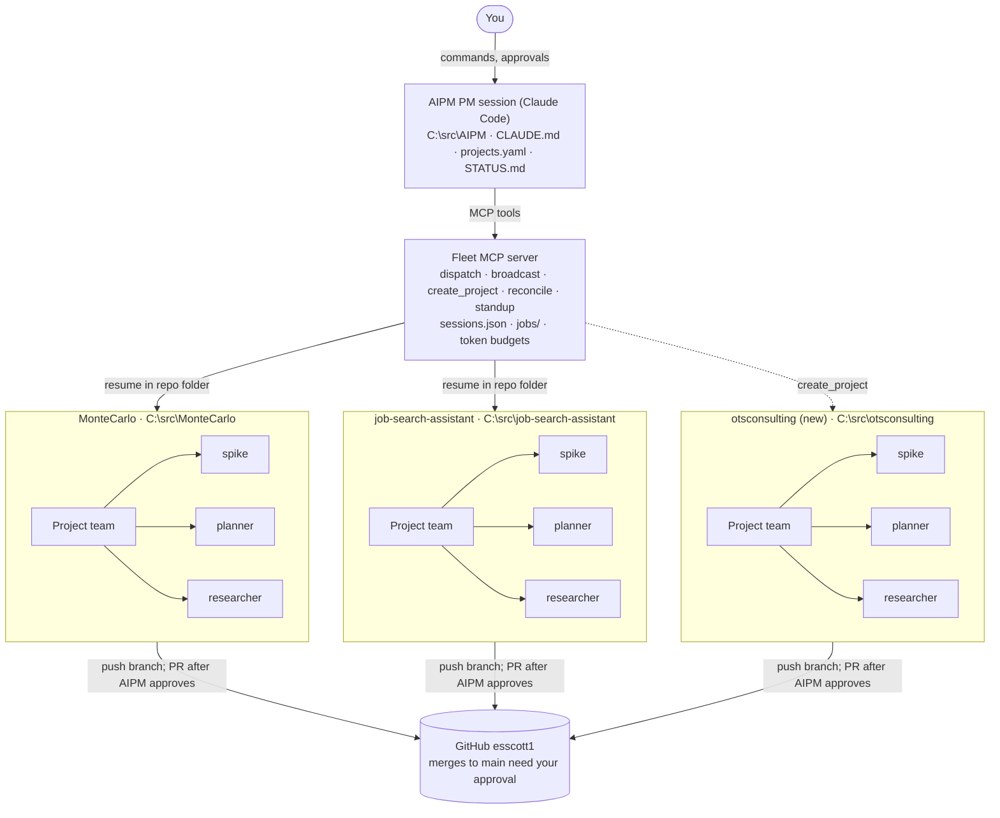

# AIPM — AI Program Manager Architecture

As of 2026-10-23 · Eric Scott

## Summary

AIPM is one Claude Code session that acts as program manager over every repo, so you stop switching between per-repo sessions. It talks to a small MCP server (the fleet server) that runs one persistent project team per repo through the Claude Agent SDK / Claude Code CLI.

- **Managed at launch:** MonteCarlo, job-search-assistant, and otsconsulting (created by AIPM).
- **Project teams** keep long-lived context in their own repo and spawn subagents for spikes, planning and research.
- **AIPM can bootstrap new projects:** create the folder, `git init`, create the GitHub remote, push, and register the team.
- **Home:** `C:\src\AIPM`, its own repo, pushed to `github.com/esscott1/AIPM`.

## Architecture



You talk only to the PM session. The PM calls the fleet server's MCP tools, and the fleet server resumes each project team inside its own repo folder. Teams commit to and push their own feature branches; the PM approves each pull request before it is opened, and nothing merges to `main` without you.

## Components

| Component | Lives in | Responsibility |
| --- | --- | --- |
| PM session | `C:\src\AIPM` (Claude Code) | Takes your commands, dispatches work, keeps `STATUS.md` current, approves PR requests, asks you before merges and repo creation |
| Fleet MCP server | `C:\src\AIPM\fleet` (Python, native Windows) | Runs project team sessions, stores session IDs, tracks background jobs and token budgets |
| Registry | `projects.yaml` (local, not in git) | Repo path, GitHub remote, goal, model, permission mode, token budget, status per project; written by the fleet tools |
| Project teams | One per repo | Claude Code session with `cwd` = the repo; uses that repo's CLAUDE.md, memory.md, skills and hooks |
| Subagents | Each repo's `.claude/agents/` | Spike, planner, researcher; spawned by the project team for scoped tasks |

**Fleet MCP tools**

- `list_projects`, `project_status(project)`
- `dispatch(project, instruction, mode)` returns a job ID; `job_status(job)`, `get_report(job)`, `cancel(job)`
- `broadcast(instruction, projects)` for the same ask across repos (e.g. "bump dependencies" or "clean up")
- `request_pr(project, branch, summary)` from a team, and `approve_pr(request)` / `reject_pr(request, reason)` from the PM
- `notify_merged(project, pr)` tells a team its PR was merged, so it can run its cleanup
- `create_project(name, visibility, template)` for the bootstrap flow below
- `standup()` rolls up git log, open PRs, the last team report and tokens used per repo

**Lifecycle tools:** `adopt_project`, `retire_project`, `pause(project)`, `resume(project)` and `reconcile(project)`, which brings AIPM up to date with anything done in the repo outside it.

**State:** git is the source of truth (a branch and PR per task). `jobs/` holds job logs, and `STATUS.md` is the rolled-up board. Each field has one home:

- `projects.yaml` is the registry. `/adopt-project` and `create_project` add entries, `pause` and `resume` set `status`, and `/retire-project` removes entries. You can edit a budget or model by hand, but never need to.
- `fleet/sessions.json` holds what changes on every run: each project's `session_id` and `last_seen_commit`.

Both files are machine-local and stay out of git, since they hold `C:\src` paths and change without a PR. `projects.example.yaml` documents the registry format. If this machine is lost, the registry is rebuilt by adopting each repo again; the repos themselves are on GitHub.

**Host: Windows.** The fleet server runs natively on Windows, the same environment as `C:\src`, VS Code and the Claude desktop app. That keeps one Claude Code session store (`%USERPROFILE%\.claude`) and one set of paths, so existing sessions can be imported, forks and `reconcile` work with sessions you run in VS Code, and the Control Panel connects to it directly as a local MCP server. Teams use your Windows `claude` and `gh` sign-ins, and their shell commands run in Git Bash. WSL is fine for one-off git and `gh` commands, but Claude Code sessions for an adopted repo always run on Windows: WSL keeps a separate session store and sees the repos as `/mnt/c/...`, so sessions don't carry across.

## Managed projects

Two existing repos are adopted at launch; otsconsulting is created by AIPM as its first bootstrap.

| Project | Local path | GitHub remote | Onboarding |
| --- | --- | --- | --- |
| MonteCarlo | `C:\src\MonteCarlo` | `esscott1/MonteCarlo` | Adopt with `/adopt-project`, optionally import an existing session |
| job-search-assistant | `C:\src\job-search-assistant` | `esscott1/job-search-assistant` | Adopt: same as above |
| otsconsulting | `C:\src\otsconsulting` | `esscott1/otsconsulting` (new) | Bootstrap via `create_project` |

Local paths assume everything sits under `C:\src`; the path is recorded when a repo is adopted or created.

Example registry entry (see `projects.example.yaml`):

```yaml
projects:
  montecarlo:
    path: C:\src\MonteCarlo
    remote: https://github.com/esscott1/MonteCarlo.git
    goal: Featured portfolio project; client-ready simulation
    model: sonnet
    permission_mode: acceptEdits   # plan | acceptEdits; bypassPermissions is rejected
    budget: { max_turns: 40, max_tokens_per_job: 1000000 }
    status: active                 # active | paused
```

The matching `fleet/sessions.json` entry, written by the fleet server and `reconcile`:

```json
{ "montecarlo": { "session_id": null, "last_seen_commit": null } }
```

## Adopting existing projects

A new AIPM knows nothing about existing repos, so each one is adopted explicitly with the `/adopt-project` skill. It is built in Phase 1, because Phase 1's exit test needs MonteCarlo adopted.

1. **Find candidates:** scan `C:\src` for git repos not yet in `projects.yaml`, or take a path you give it.
2. **Inspect the repo:** read its remote, default branch, open branches and worktrees.
3. **Check team rules:** if `CLAUDE.md` or `memory.md` is missing, offer to create it. If one exists, offer to add a short AIPM section covering PR requests, cleanup after a merge and the end-of-task report. Existing content is never overwritten. If `main` has no "Protect main" ruleset, offer to apply it.
4. **Pick up history:** list the existing Claude Code sessions for that folder and let you import one as the team's session, so the team keeps its context, or start fresh.
5. **Seed subagents:** add spike, planner and researcher only where they are missing.
6. **Register:** write the `projects.yaml` entry with goal, token budget and `status: active`, and record the current commit as `last_seen_commit` in `sessions.json`.
7. **Health check:** dispatch "report your current state", so the team's first line appears in `STATUS.md`.

`/retire-project` removes a repo from AIPM (registry entry and session mapping) without touching the repo itself.

## New-project bootstrap

`create_project` turns a one-line ask ("start otsconsulting, private") into a source-controlled repo with a ready project team. It pauses once for your approval before anything is created on GitHub.

1. **Propose:** PM drafts name, visibility, goal and template, and asks you to confirm.
2. **Scaffold:** create `C:\src\<name>`, seed `README.md`, `.gitignore`, `CLAUDE.md` (goal, standards), `memory.md` and `.claude/agents/` (spike, planner, researcher).
3. **Init:** `git init -b main`, first commit.
4. **Publish:** `gh repo create esscott1/<name> --private --source . --remote origin --push`.
5. **Protect main:** apply the "Protect main" ruleset to the new repo (see Guardrails).
6. **Register:** append the entry to `projects.yaml`.
7. **Staff:** start the project team session in the new repo, save its session ID, and hand it a kickoff task (e.g. "produce a plan for the site").

The `gh` CLI must be installed and signed in on your machine; the fleet server never stores a GitHub token.

## Project teams and subagents

Each project team is a lead session that owns its repo and delegates scoped work to subagents, which return a summary and keep the lead's context clean.

| Subagent | Use for | Tools | Output |
| --- | --- | --- | --- |
| spike | Time-boxed prototype to test an idea | Edit + Bash, in its own git worktree on a `spike/*` branch | Findings + throwaway branch |
| planner | Break a goal into steps before coding | Read-only | `docs/plans/<topic>.md` |
| researcher | Libraries, APIs, prior art, competitor sites | Read-only + web search | `docs/research/<topic>.md` |

- AIPM seeds these three from `templates/agents/`; each repo can customize or add its own.
- Subagents are scoped to their repo: they inherit the team's `cwd` and permissions, never another repo's.
- Every team task ends with a structured report (changed, tests, blockers, next step, tokens used) that the fleet server returns to the PM.

**Team-owned git workflow:** each team commits to its feature branches and creates, merges, rebases and cleans up its own worktrees, following its repo's `CLAUDE.md` and `memory.md`. Opening a pull request is the one step that needs AIPM's approval. After a merge, AIPM notifies the team, and the team deletes the merged feature branch and its worktree, either when told to clean up or because its CLAUDE.md directs cleanup after a merge.

## Guardrails

Teams own their branches and worktrees, AIPM approves pull requests, and you approve merges to main and anything irreversible.

| Action | Who decides |
| --- | --- |
| Commits to feature branches | Project team, per its CLAUDE.md and memory.md |
| Worktrees: create, merge, rebase | Project team, per its CLAUDE.md and memory.md |
| Clean up: delete merged feature branches and their worktrees | Project team, when told to clean up or when its CLAUDE.md says to after AIPM reports the merge |
| Code edits, tests, plans, research | Project team, automatically |
| Open a pull request | AIPM approves the team's request |
| Merge to `main` | You; enforced on GitHub by the "Protect main" ruleset (PR required, no bypass) |
| Create a GitHub repo, change visibility | You |
| Delete unmerged branches, files or repos | You |
| Exceed a job's turn or token budget | Job stops; PM reports it |

- Each team's `CLAUDE.md` and `memory.md` set its commit, branching, worktree and cleanup rules; AIPM does not override them.
- A team asks for a PR with `request_pr`; the PM checks the team's report against the task and approves or sends it back with a reason.
- AIPM is the source of truth for merges: a team cleans up only branches AIPM has reported as merged, so unmerged work is never deleted by a team.
- Cleanup deletes local branches with `git branch -d` only, never `-D`. A branch `-d` refuses (squash- or rebase-merged, or with commits after the merge) is skipped and reported for me to delete. Team templates and the AIPM section `/adopt-project` adds carry the same rule.
- **"Protect main" ruleset on GitHub** (GitHub Pro, so it applies to private repos): pull request required (0 approvals, since I can't approve my own PRs), no force pushes, no deleting `main`, and no bypass actors. Teams act through my GitHub sign-in, so allowing myself to bypass would let them bypass too. AIPM applies it to every repo it creates; adopted repos get it during `/adopt-project`.
- Teams start in `plan` or `acceptEdits` mode; `bypassPermissions` is never used.
- Each job has `max_turns` and a token cap from `projects.yaml`.

## Working on adopted projects outside AIPM

You can still work on an adopted repo directly, for example in VS Code with the Claude Code extension or through Remote Control from your phone, up to and including merging a PR yourself. Git and GitHub stay the source of truth, and AIPM catches up with `reconcile` rather than assuming nothing changed.

**What a direct session shares, and what it doesn't**

- **Shared through the repo:** `CLAUDE.md`, `memory.md`, `.claude/agents`, skills, branches and commits. Any Claude Code session opened in the folder loads the same team rules.
- **Not shared:** the team session's conversation context, AIPM's job queue, the PR approval queue, `STATUS.md` and token accounting.

**Impacts and how AIPM handles them**

| Done outside AIPM | Impact | How AIPM handles it |
| --- | --- | --- |
| Commits and new branches | The team session's context is stale | `reconcile` briefs the team on changes since `last_seen_commit` before its next task |
| Working on a branch or worktree while a team job is running on it | Conflicting edits or a broken worktree | Pause the project first; a job stops and reports if its checkout changed underneath it |
| Opening a PR yourself | It skipped AIPM's PR approval | Standup lists it as opened outside AIPM; no automatic action |
| Merging a PR yourself | AIPM never sent the merge notice | `reconcile` sees the merge through `gh` and sends `notify_merged`, so the team cleans up unless you already did |
| Resuming the team's own session ID in VS Code | Two histories diverge and the team loses track | Don't; start a new session or fork the team's |
| Decisions made in your session | The team never learns them | Record them in `memory.md` before you finish |
| Tokens used directly | Missing from AIPM's token report, but drawn from the same Max plan allowance | AIPM jobs may hit plan limits sooner |

**Instructions: a feature from start to merge, outside AIPM**

1. **Pause the team.** In AIPM, `/pause montecarlo`, or Pause on the control panel. Let a running job finish or cancel it; new dispatches wait.
2. **Start a new session** in VS Code in `C:\src\MonteCarlo`. Don't resume the team's session. If you want its context, fork it: `claude --resume <team-session-id> --fork-session`.
3. **Work normally.** The extension loads the repo's `CLAUDE.md`, so the team's branch naming, worktree and commit rules still apply.
4. **Open and merge the PR yourself** if you want. Merging to `main` is your call either way; note in the PR description that it was done outside AIPM.
5. **Update memory.** Before closing, have the session add a short entry to `memory.md` (what changed, decisions, gotchas) and commit it.
6. **Clean up or leave it.** Delete the branch and worktree yourself, or leave them: once `reconcile` reports the merge, the team cleans up under its own rules.
7. **Resume the team.** `/resume montecarlo` runs `reconcile`: fetch, record merged PRs, send `notify_merged`, brief the team session and refresh `STATUS.md`.

If you forget to pause, `reconcile` still runs before every dispatch, so the team is briefed. The remaining risk is a job running on the same branch at the same moment, and that job stops and reports instead of overwriting your work. Remote Control of a VS Code session counts as working outside AIPM, and the same steps apply.

## Interfaces (Phase 4)

AIPM has two front ends over the same fleet server and guardrails: the PM session for conversation, and the AIPM Control Panel artifact for status and one-click approvals.

| Interface | Where | Best for | How it reaches the fleet server |
| --- | --- | --- | --- |
| PM session | Claude Code in `C:\src\AIPM` (terminal or the desktop app's Code tab) | Planning, dispatching, discussing results | Directly, through `.mcp.json` |
| Control Panel on your PC | Artifact in your claude.ai account, opened in the Claude desktop app | Status at a glance, PR approvals, quick dispatches, "clean up" | As a local MCP server the desktop app connects to |
| Control Panel elsewhere | Same artifact on your phone or in a browser | Checking last-known status | It doesn't; shows the last saved snapshot, read-only |

**Control Panel features**

- Status board per repo: running jobs, tokens used against budget, last team report
- PR request queue with Approve and Reject (a reason is required to reject)
- Dispatch a task to one team, or broadcast to several
- Standup roll-up and merge notices
- A snapshot saved to the artifact's database on each refresh, so other devices see last-known state

**Setup**

1. Add the fleet server to the Claude desktop app's MCP configuration, alongside the PM session's `.mcp.json`.
2. Keep the panel's source in `C:\src\AIPM\dashboard` and publish it to your account as an artifact.
3. The page declares only the fleet tools it calls; the desktop app asks you once to allow them.

**Limits**

- Live controls work only in the Claude desktop app on the PC running the fleet server.
- The panel has no extra powers: it calls the same fleet tools, under the same guardrails, as the PM session.

## Billing and authentication

AIPM is for personal use on your Max plan. The fleet server runs the unmodified `claude` CLI headless (`claude -p --resume <id> --output-format json`) signed in with your own subscription, and never reads, stores or forwards your login token. If AIPM is ever offered to clients or other users, switch to API key authentication ([legal and compliance](https://code.claude.com/docs/en/legal-and-compliance), [Agent SDK overview](https://code.claude.com/docs/en/agent-sdk/overview)).

## Risks and open decisions

**Risks**

- **Sessions are tied to their folder.** Claude stores sessions under `~/.claude/projects/<encoded-cwd>/`, so a resume from a different directory finds nothing. The fleet server always resumes a team from its registered path; moving a repo means re-registering it.
- **Token use multiplies** with parallel teams and subagents, all drawn from one Max plan allowance; token budgets in `projects.yaml` are the control.
- **Agent Teams is not the base.** It is experimental and interactive-only, built to coordinate sessions on one codebase; AIPM needs separate repos with long-lived context.

**Open decisions**

- [ ] Does job-search-assistant get its own repo, or stay inside `esscott1/ClaudeCowork`?
- [ ] Visibility for new repos by default: private or public (portfolio).
- [x] Fleet server host: native Windows (see Components).
